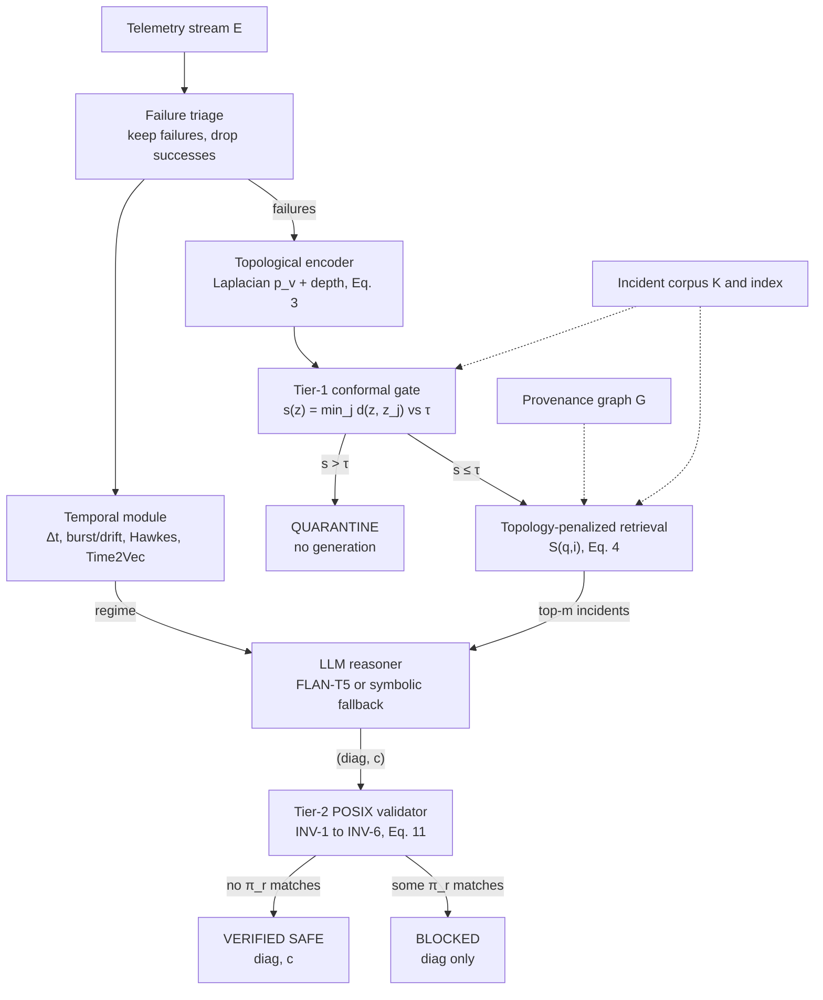

# TopoSafeRAG: Safe Failure Diagnosis from OS Telemetry

**Ashwin R (25MIS0218), George Peter (25MIS0167), Revin Rajesh (25MIS0111)**
Department of Computer Software Engineering, Vellore Institute of Technology, Vellore, India
ashwin.official62@gmail.com, kachappillygeorgepeter@gmail.com, revinrajesh26@gmail.com

---

## Abstract

Operating-system telemetry is a firehose, and operators still have to find the root cause and decide what to run. Retrieval-augmented generation (RAG) with large language models fits the job, but flat-text retrieval throws away process and call provenance, flattens time into tokens, and has no sane response to a fault it has never seen or a shell command it should never run. TopoSafeRAG goes after all three. Its retriever penalizes provenance-graph distance and carries graph-Laplacian positional encodings; a continuous-time module models inter-event latency, burst and drift regimes, a Hawkes-style intensity and a Time2Vec encoding; and a two-tier safety layer pairs a split-conformal-style distance gate (τ = 0.85) with a deterministic validator of six POSIX invariants. We ran the pipeline on a single-host fault-injection workload of 1,746 events, 471 of them failures. All 471 (100%) passed the distance gate, none were blocked, and all were marked verified safe; 52.77% of inter-failure gaps were bursts (< 2.0 s). The workload contains no malicious payloads and no unfamiliar fault classes, so these results show the pipeline runs end to end. They do not show that the gate catches out-of-distribution events. No baseline was run, so we report no outperformance percentage.

**Index Terms** — AIOps, conformal prediction, failure diagnosis, log analysis, operating-system telemetry, retrieval-augmented generation, safe remediation, temporal point processes

---

## I. Introduction

Operating systems and the services on top of them never stop talking: logs, exceptions, route errors, resource events. AIOps tries to turn that stream into diagnoses fast enough to matter, and recent surveys show large language models (LLMs) moving quickly into failure management [1]. We study failure diagnosis over operating-system telemetry. The input is a stream of timestamped events with provenance fields, plus a corpus of past incidents. For each failure the system must return one of two things: (a) a diagnosis with a remediation that has passed verification, or (b) a quarantine decision that withholds automated action.

Existing solutions only partly meet this need. Log-based anomaly detectors such as DeepLog, LogAnomaly, LogRobust and LogBERT [2]–[5] score event sequences well, but they hand back a label or a score, and an operator still has to work out what broke and what to do. LLM-based incident tools [6], [7] do produce narratives and mitigation suggestions, and they inherit the hallucination behaviour of generative models [8]. That is tolerable in prose, but it is a hazard when the output is a shell command. Three gaps follow:

1. **Topological flattening.** Embed events as free text and the links between a failing request and its process, trace and module disappear, so retrieval returns incidents that read alike but come from unrelated provenance.
2. **Temporal discretization.** Inter-event latency usually becomes a token or gets dropped, yet bursts and slow drifts carry diagnostic information.
3. **Open-world hallucination.** A retrieval-augmented generator cannot abstain in a calibrated way on unfamiliar faults, and nothing deterministic sits between generated text and a destructive command.

Each gap is tolerable alone. Together they argue for one pipeline that retrieves by text and provenance, represents timing explicitly, and refuses to act when an event looks unfamiliar or a command looks unsafe. This paper makes four contributions toward that pipeline:

1. A retrieval rule that multiplies text similarity by an exponential penalty on provenance-graph distance, with events augmented by Laplacian spectral and depth encodings.
2. A continuous-time treatment of inter-event latency: a 2.0 s burst/drift threshold, a Hawkes-style intensity specification, cascade acceleration and a Time2Vec encoding.
3. A two-tier safety layer: a nearest-neighbour distance gate with threshold τ = 0.85, followed by a deterministic validator of six POSIX invariants (INV-1 to INV-6).
4. An end-to-end implementation and a descriptive characterization of 1,746 events from a single-host fault-injection workload, including a plain account of what that workload can and cannot show.

In operation, the pipeline ingests telemetry and separates failures from successes (failure triage), encodes each failure with topological (Laplacian and depth) and temporal (burst/drift, Time2Vec) features, and computes its nearest-neighbour distance, quarantining anything beyond τ (Tier-1 gate). Surviving events retrieve the top-scoring incidents with topology-penalized similarity, a diagnosis and remediation are generated with FLAN-T5 or a symbolic fallback, and the command is checked against INV-1 to INV-6 (Tier-2) before a verified-safe, quarantined or blocked status is emitted.

The rest of the paper is organized as follows. Section II reviews related work and the gaps it leaves. Section III covers preliminaries, architecture, algorithm and dataset. Section IV reports results, discussion and limitations. Section V concludes and lists future work.

---

## II. Literature Survey

This section covers prior work on log-based failure diagnosis, retrieval-augmented incident analysis, provenance-aware representations, temporal point processes, conformal gating and safe command generation. We cite only what bears on the problem above.

**2(a) Log-based anomaly detection.** DeepLog [2] models a log as a sequence with a recurrent network so it can learn normal execution patterns, and it builds workflows to support diagnosis. It flags deviations but never retrieves a past incident. LogAnomaly [3] adds template semantics to catch both sequential and quantitative anomalies, and stops short of remediation. LogRobust [4] uses an attention-based bidirectional recurrent model to survive unstable log events; LogBERT [5] applies self-supervised transformer pre-training. Both return scores, not explanations. Drain [9] parses streams online with a fixed-depth tree, and Loghub [10] gathers 19 real-world log datasets for this line of work. None of it is built to retrieve incidents or verify commands.

**2(b) RAG for AIOps and root-cause analysis.** RAG pairs a parametric generator with a non-parametric memory [11]. An empirical study at Microsoft [7] tested LLMs at recommending root causes and mitigations across more than 40,000 incidents. RCACopilot [6] collects diagnostic data automatically, predicts root causes with an LLM and writes an explanatory narrative. A survey [1] maps LLM-based AIOps across failure perception, root-cause analysis and auto-remediation. All of these work on incident records rather than process-level provenance, and verifying generated actions is not their stated focus.

**2(c) Graph- and provenance-aware representations.** GraphRAG [12] builds an entity knowledge graph with community summaries to answer corpus-level queries. Eadro [13] runs a graph attention network over traces, logs and KPIs to model inter-service dependencies for microservice troubleshooting. Laplacian eigenvectors extend sinusoidal transformer encodings to graphs [14], [15]. These target localization or question answering. None conditions incident retrieval on provenance.

**2(d) Temporal point processes and time encodings.** The Hawkes process [16] captures self-excitation, and the neural Hawkes process [17] lets a recurrent network shape the intensity. Time2Vec [18] learns a vector representation of time, and temporal convolutional networks [19] offer a non-recurrent alternative. Failure cascades look like natural self-exciting processes, but the surveyed works do not fit these models to OS telemetry diagnosis.

**2(e) Conformal prediction and OOD gating.** Conformal prediction gives finite-sample guarantees under exchangeability [20], [21]. Split conformal inference [22] calibrates a threshold on held-out scores, conformal risk control [23] extends the idea to monotone losses, and conformal p-values [24] support outlier testing. C-RAG [25] applies conformal risk analysis to retrieval-augmented models and delivers certified risk bounds, not a per-event gate. Distance- and energy-based OOD detectors [26], [27] target classifiers, not incident retrieval.

**2(f) Safety of generated commands.** NL2Bash [28] maps natural language to shell commands. ToolEmu [29] reports that even the safest evaluated LLM agent failed in 23.9% of emulated high-stakes test cases, according to its automatic evaluator. Hallucination is surveyed in [8]. Numbers like that justify a deterministic barrier after generation.

**Table I. Summary of surveyed work**

| Citation | Approach / Method | Strengths / Merits | Gaps |
|---|---|---|---|
| [2]–[5] | Sequence/transformer log anomaly detection | Strong anomaly scoring on logs | No incident retrieval, provenance, abstention or command verification |
| [6], [7] | LLM incident root-cause and mitigation | Narratives and mitigation suggestions | Incident records only; no provenance; no verification of actions |
| [12], [13] | Graph RAG / graph-based RCA | Uses dependency structure | Not incident retrieval; no abstention or verification |
| [16]–[18] | Hawkes, neural Hawkes, Time2Vec | Self-excitation and continuous time | Not applied to OS failure diagnosis |
| [20]–[25] | Conformal prediction, C-RAG | Finite-sample guarantees; certified risk bounds | Risk bounds, not per-event gate; no provenance or command checks |
| [28], [29] | NL2Bash, ToolEmu | Quantify command and agent risk | Evaluation only; no deterministic barrier |

### A. Drawbacks identified and research gaps addressed

1. Anomaly detectors output scores, not diagnoses or actions.
2. LLM incident tools do not use process-level provenance.
3. Time is discretized or ignored; bursts and drift go unmodelled.
4. Incident retrieval has no calibrated-style abstention on unfamiliar faults.
5. Generated remediation commands have no deterministic verification barrier.

The present work goes after all five in one pipeline. We found no surveyed work that combines provenance-conditioned retrieval, a calibrated-style abstention gate and deterministic command verification. That claim covers the surveyed set only. It is not an exhaustive novelty claim.

---

## III. Preliminaries and Proposed Architecture

This section formalizes the problem, then walks through the architecture, algorithm, dataset and the reasoning behind the design.

### A. Preliminaries

Let $E = \{e_1, \dots, e_N\}$ be a telemetry stream ordered by timestamp. Each failure event is the tuple

$$e_i = (t_i, h_i, p_i, tr_i, m_i, \ell_i, \rho_i, y_i, s_i, x_i) \tag{1}$$

where $t_i$ is the timestamp, $h_i$ the host, $p_i$ the process identifier, $tr_i$ the trace identifier, $m_i$ the source module, $\ell_i$ the line, $\rho_i$ the route, $y_i$ the event type, $s_i$ the severity and $x_i$ the message text. The inter-event latency is $\Delta t_i = t_i - t_{i-1}$. A provenance graph $G = (V, E_G)$ links hosts, processes, incident groups and modules, and $d_G(\cdot,\cdot)$ is shortest-path distance on $G$. A corpus $K = \{k_j\}$ stores past incidents with diagnoses $\delta_j$, and $\varphi(\cdot)$ maps text to an embedding.

**Objectives.**
- **(O1)** retrieve incidents that are close in both text and provenance;
- **(O2)** represent timing so bursts and drift stay distinguishable;
- **(O3)** quarantine events whose nearest-neighbour distance exceeds τ;
- **(O4)** guarantee that no accepted remediation command matches a destructive invariant.

The dataset has no ground-truth root-cause labels, so O3 and O4 can be judged only through pipeline outcomes, and O1 and O2 only descriptively.

### B. Proposed architecture

Telemetry comes in, failure triage splits failures from successes, and each failure gets topological and temporal features. The conformal gate computes a nearest-neighbour distance and either quarantines the event or passes it to topology-penalized vector retrieval. An LLM reasoner (FLAN-T5 [30], with a symbolic fallback) drafts a diagnosis and remediation. The POSIX validator then accepts or blocks the command. Fig. 1 shows the components and data flow.



*Fig. 1. Architecture of TopoSafeRAG. Solid arrows carry event data; dashed arrows carry stored resources (provenance graph G, incident corpus K). The Tier-1 gate (Eqs. 8–10) can quarantine an event before generation; the Tier-2 validator (Eq. 11) accepts or blocks the drafted command.*

### C. Topology-penalized retrieval

Let $A$ be the adjacency matrix of $G$ and $D$ its degree matrix. The normalized Laplacian and its eigendecomposition are

$$L = I - D^{-1/2} A D^{-1/2} = U \Lambda U^\top \tag{2}$$

The spectral encoding of node $v$ uses the $k$ smallest nontrivial eigenvectors, $p_v = [u_2(v), \dots, u_{k+1}(v)] \in \mathbb{R}^k$ [14], and $dep(v)$ is the hop depth from the host root. The topological feature is

$$e_{topo}(v) = [\, p_v \;;\; dep(v) \,] \tag{3}$$

For a query $q$ and a stored incident $i$, the topology-penalized similarity is

$$S(q, i) = \cos\big(e_{text}(q), e_{text}(i)\big) \cdot \exp\big(-\gamma\, d_G(q, i)\big) \tag{4}$$

Here $e_{text} = \varphi(\cdot)$ is the text embedding, $d_G$ is the shortest-path hop distance between the provenance nodes of $q$ and $i$, and $\gamma \ge 0$ is the penalty coefficient. Set $\gamma = 0$ and (4) collapses to flat cosine retrieval, so the baseline sits inside the design. We did not study the value of $\gamma$ or its sensitivity. The corpus is searched with an exact or approximate nearest-neighbour index [31].

### D. Continuous-time latency module

Let $\delta = 2.0$ s be the regime threshold. Each gap gets a label:

$$\varrho_i = \begin{cases} \text{burst} & \Delta t_i < \delta \\ \text{drift} & \Delta t_i \ge \delta \end{cases} \tag{5}$$

A burst episode is a contiguous run of burst-labelled gaps. The self-exciting intensity takes the exponential-kernel Hawkes form [16]:

$$\lambda(t) = \mu + \sum_{t_i < t} \alpha\, e^{-\beta (t - t_i)}, \qquad \alpha/\beta < 1 \tag{6}$$

with baseline rate $\mu$, excitation $\alpha$ and decay $\beta$. We did not estimate these three in this study. The empirical analogue is the event rate $r_b = n_b / w$ in time bin $b$ of width $w$, with cascade acceleration $a_b = (r_b - r_{b-1}) / w$. For learned models, time is encoded with Time2Vec [18]:

$$t2v(\tau)[0] = \omega_0 \tau + \varphi_0, \qquad t2v(\tau)[j] = \sin(\omega_j \tau + \varphi_j) \tag{7}$$

for $j = 1 \dots K$, with learnable frequencies $\omega_j$ and phases $\varphi_j$.

### E. Tier-1: conformal distance gate

Let $z = \varphi(x)$ be the embedding of an incoming event and $\{z_j\}$ the embeddings of reference incidents. The non-conformity score is the nearest-neighbour distance:

$$s(z) = \min_j d(z, z_j) \tag{8}$$

where $d$ is normalized to $[0, 1]$ (0 identical, 1 maximal divergence). In split-conformal calibration [21], [22], scores $s_1, \dots, s_n$ on a held-out calibration set give the threshold

$$\tau_\alpha = \text{the } \lceil (n+1)(1-\alpha) \rceil / n \text{-quantile of } \{s_1, \dots, s_n\} \tag{9}$$

and the decision rule is

$$g(z) = \begin{cases} \text{in-distribution} & s(z) \le \tau \\ \text{quarantine} & s(z) > \tau \end{cases} \tag{10}$$

Under exchangeability, an in-distribution event exceeds $\tau_\alpha$ with probability at most $\alpha$ [20], [24]. Read that guarantee carefully. It bounds false quarantine of familiar events. It says nothing about power to detect novel faults. In the reported run the threshold was the fixed value $\tau = 0.85$. We evaluated no held-out calibration split, no level $\alpha$ and no empirical coverage, so the gate is split-conformal in form only, and we make no coverage claim.

### F. Tier-2: POSIX invariant validator

The validator is deterministic. A proposed command $c$ is accepted only if no rule predicate $\pi_r$ matches it:

$$\text{accept}(c) = \bigwedge_{r \in R} \neg \pi_r(c), \qquad R = \{\text{INV-1}, \dots, \text{INV-6}\} \tag{11}$$

The validator reads command text and nothing else. It cannot judge whether a diagnosis is correct, and a pattern-based check blocks only the patterns it encodes. Alternative flag orders and wrapped invocations will slip past it. Closing that hole takes an allowlist over a typed action schema or a parsed grammar, which we leave to future work.

**Table II. POSIX invariant rules**

| Rule | Blocked behaviour |
|---|---|
| INV-1 | Recursive forced removal targeting the filesystem root (root wipe) |
| INV-2 | Filesystem creation on a device (`mkfs`) |
| INV-3 | Raw block-device writes with `dd` |
| INV-4 | Forced kill of the init process (`kill -9` on PID 1) |
| INV-5 | World-writable permissions on the root directory (`chmod 777 /`) |
| INV-6 | Overwriting `/etc/passwd` |

### G. Algorithm

Algorithm 1 formalizes the full pipeline of Fig. 1 for a telemetry stream. It combines topological precomputation (Eqs. 2–3), the continuous-time latency analysis (Eqs. 5–6), the Tier-1 gate with topology-penalized retrieval (Eqs. 4, 8, 10) and the Tier-2 validator (Eq. 11). To avoid a clash with the spectral dimension $k$ of Eq. (3), the number of retrieved incidents is written $m$ here ("top-k" in the earlier description).

**Algorithm 1. TopoSafeRAG: batch inference with temporal analysis, gating, retrieval and verification**

**Require:** Stream $E$ with fields of Eq. (1); provenance graph $G = (V, E_G)$ with host root $v_0$ and node map $\nu(\cdot)$; corpus $K = \{(z_j, v_j, \delta_j)\}_{j=1}^n$; gate threshold $\tau$; penalty $\gamma \ge 0$; regime threshold $\delta$; spectral dimension $k$; retrieval size $m$; bin width $w$; rule set $R$; Hawkes parameters $(\mu, \alpha, \beta)$ supplied, not estimated.

**Ensure:** Results $\Omega = \{(\text{diag}_i, c_i, \text{status}_i)\}$; burst episodes $B$; bin rates $\{r_b\}$ and accelerations $\{a_b\}$.

```
Phase 0: topological precomputation
 1: L ← I − D^(-1/2) A D^(-1/2);  (U, Λ) ← EIGENDECOMPOSE(L)      ▷ eigenvalues ascending, Eq. (2)
 2: dep(·) ← BFSDEPTH(G, v0)
 3: for each v ∈ V do
 4:     e_topo(v) ← [u2(v), …, u_{k+1}(v) ; dep(v)]                ▷ Eq. (3)

Phase I: failure triage and continuous-time latency analysis
 5: F ← ⟨e_i ∈ E : ISFAILURE(y_i)⟩ ordered by t_i;  A ← 0;  B ← ∅;  ϱ_1 ← ⊥
 6: for i = 2 to |F| do
 7:     Δt_i ← t_i − t_{i−1};  A ← e^(−β Δt_i) (1 + A);  λ_i ← µ + α A   ▷ recursive form of Eq. (6)
 8:     if Δt_i < δ then
 9:         ϱ_i ← burst
10:     else
11:         ϱ_i ← drift                                            ▷ Eq. (5)
12: i ← 2
13: while i ≤ |F| do                       ▷ extract maximal runs of burst gaps
14:     if ϱ_i = burst then
15:         j ← i
16:         while j < |F| and ϱ_{j+1} = burst do
17:             j ← j + 1
18:         B ← B ∪ {(i, j)};  i ← j + 1
19:     else
20:         i ← i + 1
21: n_b ← 0 for all bins b;  for i = 1 to |F| do n_{⌊(t_i − t_1)/w⌋} ← n_{⌊(t_i − t_1)/w⌋} + 1
22: for each bin b do
23:     r_b ← n_b / w;  a_b ← (r_b − r_{b−1}) / w for b ≥ 1        ▷ rate and cascade acceleration

Phase II: Tier-1 gate and topology-penalized retrieval (nested scan)
24: H ← ∅                                                          ▷ cache of hop-distance tables
25: for i = 1 to |F| do
26:     f ← F[i];  v ← ν(f)
27:     if v ∉ H then
28:         H[v] ← BFSHOPS(G, v)                                   ▷ d_G(v, ·)
29:     z ← φ(x_i);  s ← +∞;  N ← ∅                                ▷ N: bounded top-m heap
30:     for j = 1 to n do
31:         d_j ← DIST(z, z_j);  s ← min(s, d_j)                   ▷ Eq. (8)
32:         S_j ← cos(z, z_j) · exp(−γ H[v][v_j])                  ▷ Eq. (4)
33:         if |N| < m or S_j > MINSCORE(N) then
34:             INSERTBOUNDED(N, (j, S_j), m)
35:     if s > τ then                                              ▷ Eq. (10)
36:         Ω_i ← (∅, ∅, QUARANTINE);  continue

Phase III: generation and Tier-2 verification
37:     (diag, c) ← REASON(f, ϱ_i, {δ_j : (j, ·) ∈ N})             ▷ FLAN-T5 or symbolic fallback
38:     ok ← true;  r ← 1
39:     while ok and c ≠ ∅ and r ≤ |R| do
40:         if π_r(c) then
41:             ok ← false
42:         r ← r + 1
43:     if ok then
44:         Ω_i ← (diag, c, VERIFIED SAFE)                         ▷ Eq. (11) holds
45:     else
46:         Ω_i ← (diag, ∅, BLOCKED)
47: return Ω, B, {r_b}, {a_b}
```

**Phases.** Phase 0 builds the spectral and depth features of the provenance graph once. Phase I keeps only failures, computes each gap $\Delta t_i$, labels it burst or drift, evaluates the exponential-kernel Hawkes intensity through the recursion $A_i = e^{-\beta \Delta t_i}(1 + A_{i-1})$ so that no past event is revisited, groups burst gaps into episodes with a nested while loop, and computes the binned rates and cascade accelerations. Phase II scans the corpus once per failure, and the same scan yields both the nearest-neighbour distance $s$ for the Tier-1 gate and the topology-penalized scores for retrieval, so quarantined events never reach the generator. Phase III drafts a diagnosis and command from the retrieved incidents and the regime label, then tests the command against each rule predicate $\pi_r$ and stops at the first match. The Hawkes parameters are inputs here because this study did not estimate them, and $\lambda_i$, $\{r_b\}$ and $\{a_b\}$ are reported to the operator but are not passed to the reasoner, which receives only the event, the regime label and the retrieved incidents as in Section III-B.

**Complexity.** Let $F = |\mathcal{F}|$ be the number of failures, $d$ the embedding dimension, and $B$ the number of time bins. Phase 0 costs $O(|V|^3)$ for a dense eigendecomposition (less with a sparse solver) plus $O(|V| + |E_G|)$ for the depth search. Phase I costs $O(N + F + B)$, because every gap, episode run and bin is visited a constant number of times. In Phase II the hop tables are built at most once per distinct provenance node, $O(|V|(|V| + |E_G|))$ in the worst case, and the nested scan costs $O(F\,n\,(d + \log m))$ with an exact index. Phase III costs $O(F\,|R|\,|c|_{max})$ for validation plus the reasoner's own inference cost, which we do not bound. The total is dominated by the scan, $O(F\,n\,(d + \log m))$, when $n$ is large. Space is $O(|V|k + nd + |V|^2 + F + B)$, where the $|V|^2$ term is the worst-case hop-table cache.

**Novelty.** The components are existing ones (Laplacian encodings, Hawkes intensity, split-conformal-style distance gating, pattern-based command checks). What Algorithm 1 adds is a single formal specification that couples them: one corpus scan serves both the gate and the penalized retrieval, the Hawkes intensity is evaluated by an O(1)-per-event recursion, and the generator is reachable only through the gate and always followed by the validator. We claim this as a formalization of the pipeline, not as a new theoretical result or a measured improvement.

### H. Dataset description

The data is telemetry from one host (DESKTOP-N00M686), produced by a scripted Flask test application whose endpoints (for example `/crash`, `/db/constraint`, `/external/timeout`) inject faults. This is synthetic fault injection on a single machine. It has no malicious payloads and no true zero-day faults.

**Preprocessing.** We separated failures from successes and extracted the fields of Eq. (1). For 404 of the 471 failure rows the source-file field was empty and defaulted to `system_framework/app.py`, so the module statistics reflect that default, not observed provenance. We computed gaps $\Delta t_i$ over the ordered failure stream, which gives 470 gaps.

**Data limitations.** The workload is single-host and synthetic. Most non-LOG rows carry only event type, category and severity. One fault request can yield several rows within milliseconds, so event counts and burst statistics overstate the number of distinct faults. No CPU, memory or I/O counters exist. Every result below sits inside these bounds.

**Table III. Dataset summary**

| Quantity | Value |
|---|---|
| Telemetry events | 1,746 |
| Failures (share of events) | 471 (26.98%) |
| Successes | 1,275 |
| Hosts | 1 |
| Failure event types | 6 |
| Source modules | 3 |
| Inter-event gaps among failures | 470 |

### I. Justification and strengths

- Provenance penalization keeps retrieved incidents structurally relevant, and $\gamma = 0$ recovers flat cosine retrieval, so the design strictly generalizes the baseline.
- Explicit burst/drift labelling and Hawkes/Time2Vec features keep the timing information that flat-text methods throw away.
- The Tier-1 gate gives a principled abstention path before generation, with a false-quarantine guarantee that is well defined under exchangeability.
- The Tier-2 validator is deterministic and auditable. It works whatever the generator does.

The next section covers the experimental environment and the results.

---

## IV. Results and Discussion

We report descriptive results on the 471 failures and say plainly where they stop being informative. There are no root-cause labels and no baselines, so we report no accuracy, F1, mean-time-to-repair or baseline comparison. The data cannot support them.

### A. Hardware and software used

**Software.** Python with pandas and NumPy; FAISS [31] with sentence embeddings and an n-gram TF-IDF fallback for retrieval; FLAN-T5 [30] with a symbolic fallback for generation; and a Chart.js dashboard that reads JSON files exported by the analysis script. The exported artifacts do not record which retrieval path (neural or fallback) produced the reported outputs.

**Hardware.** The experiments ran on the single Windows host named above. CPU, RAM and GPU specifications were not recorded and should be added by the authors.

### B. Results

**Failure distribution and module concentration.** SERVER_ERROR accounts for 194 failures (41.19%) and ROUTING_ERROR for 110 (23.35%). Add LOG and the three cover 78.77%.

**Table IV. Failure event types (N = 471)**

| Event type | Count | Share (%) |
|---|---|---|
| SERVER_ERROR | 194 | 41.19 |
| ROUTING_ERROR | 110 | 23.35 |
| LOG | 67 | 14.23 |
| HTTP_EXCEPTION | 50 | 10.62 |
| DB_ERROR | 33 | 7.01 |
| HTTP_ERROR | 17 | 3.61 |

*Fig. 2. Failure counts by event type (bar chart, N = 471). See `Output/RUN_3/failures_by_event_type.png`.*

By module, `system_framework/app.py` carries 404 failures (85.77%), Flask `app.py` 66 (14.01%) and `client_app.py` 1 (0.21%). Since 404 rows were defaulted to the first module, that concentration is an imputation artifact. It is not evidence of a dominant fault source.

*Fig. 3. Failures by source module (N = 471; 404 rows defaulted to `system_framework/app.py`). See `Output/RUN_3/top_failing_components.png`.*

**Temporal dynamics and bursts.** Failures arrive in two sessions. Roughly 300 accumulate within about one hour on the first day (read from the plot), the curve stays flat for roughly 16 h, and the remainder arrive in a short burst shortly before 06:00 UTC on the second day.

*Fig. 4. Cumulative failures over time (N = 471, UTC). See `Output/RUN_3/failures_over_time.png`.*

Across the 470 gaps the median was 1.497 s and the 90th percentile 13.174 s.

*Fig. 5. Histogram of inter-event latency Δt (s), 470 gaps, range 0–120 s. See `Output/RUN_3/inter_event_deltat_distribution.png`.*

**Table V. Burst episode summary**

| Statistic | Value |
|---|---|
| Burst gaps (Δt < 2.0 s) | 248 (52.77%) |
| Drift gaps (Δt ≥ 2.0 s) | 222 (47.23%) |
| Burst episodes | 67 |
| Peak episode rate (events/s) | 23.96 |

**Conformal-distance distribution.** Nearest-neighbour distances ran from 0.2832 to 0.8385 with a mean of 0.4283, so the maximum sits 0.0115 below τ = 0.85. One value, 0.4271, accounts for 437 incidents (92.8%). A small group sits near 0.3, a smaller one near 0.48, and a sparse tail reaches toward the threshold.

*Fig. 6. Nearest-neighbour retrieval distance (N = 471) with KDE; mean 0.428; τ = 0.85. See `Output/RUN_3/conformal_distance_distribution.png`.*

**Severity and safety outcomes.** Severity was LOW for 354 failures (75.16%) and HIGH for 117 (24.84%). All 471 failures were in-distribution. None was out-of-distribution, none was blocked, and all 471 were marked verified safe.

*Fig. 7. Severity distribution (LOW = 354, HIGH = 117). See `Output/RUN_3/severity_distribution.png`.*

**Pipeline funnel.** The pipeline ingested 1,746 events and kept 471 after failure triage. All 471 survived both the conformal in-distribution stage and the verified-safe stage. Only triage filtered anything, removing 1,275 successes.

**Latency proxy and ingest–failure association.** The `duration_ms` field, available for 544 events, had median 18.0 ms and mean 269.3 ms, with a minority of events in the 1–4 s range. It is a latency proxy, not a hardware counter.

*Fig. 8. Histogram of `duration_ms` (ms), n = 544, with KDE.*

Ingest volume against failures per minute, over N = 41 one-minute bins, gave Pearson r = 0.8902 (95% Fisher-z interval 0.80–0.94). Treat this as descriptive only. Failures are a subset of ingested events, so the two series are partly dependent by construction. The interval also assumes independence, which time-binned data violates, so it is optimistic.

### C. Discussion

#### (a) Inferences

- **A few event types dominate.** The 52.77% burst share and the 23.96 events/s peak fit a pattern of alternating bursts and quiet periods, but one injected fault can emit several rows within milliseconds, so part of that burst share is multi-row emission, not independent failures. The temporal structure comes from scripted sessions, so a long-range dependence analysis would tell us nothing.
- **The distance score barely varies** (92.8% at one value), which means retrieval diversity is low. Likely causes, which we did not isolate, are rows without a message (the text reduces to event type and category) and a workload that repeats a few faults. We do not know how the gate behaves on a more diverse corpus.
- **The 100% in-distribution, 0% blocked and 100% verified-safe outcomes show one thing:** on a benign workload the pipeline finishes without spurious quarantine or blocking. The workload has no adversarial inputs and no unfamiliar fault classes, so the gate never saw an OOD event and the validator never received a command matching INV-1 to INV-6. The last two funnel stages equal the failure count and show no filtering effect. The safety tiers were not stress-tested.

#### (b) Superiority claims and limitations

We claim no superiority over any baseline.

**Internal validity.** No baseline was run, so no outcome can be attributed to topology penalization, temporal features or the gates. The 0.85 threshold was a fixed constant, not a calibrated quantile, and queries were drawn from the same set as the knowledge base, so retrieval distances are optimistic. Diagnoses may have been computed once per distinct event profile and copied across rows, which would make the effective sample size the number of distinct profiles. The exported artifacts do not record whether the neural path or the symbolic fallback produced the diagnoses, and an audit of an earlier output file found diagnoses matching the fallback dictionary, so the contribution of retrieval is unverified. The provenance graph is a proxy because no parent-process identifier exists; structure is limited to host, process session, incident group and module.

**External validity.** The data come from one host running a toy Flask application in two test sessions, with no malicious payloads, no zero-days and no production-scale variation. Nothing here transfers to other systems or kernel-level telemetry.

**Construct validity.** The 0% OOD and 0% blocked outcomes measure the absence of the events the gates exist to catch. They say nothing about the gates' sensitivity. The module distribution is dominated by a default value, the duration field is a proxy, burst statistics are inflated by multi-row faults, hardware metrics are absent, and the Tier-2 validator checks command text, not diagnostic correctness.

---

## V. Conclusion

TopoSafeRAG combines provenance-penalized retrieval (Eq. 4), continuous-time latency modelling with a 2.0 s burst/drift threshold, and a two-tier safety layer (a τ = 0.85 gate plus six POSIX invariants) for operating-system failure diagnosis. Against the objectives: the pipeline processed all 471 of 1,746 events classed as failures end to end (O3, O4) with no spurious quarantine or blocking. The descriptive analyses found six failure types, 248 burst gaps (52.77%) in 67 episodes with a 23.96 events/s peak (O2), and nearest-neighbour distances of 0.2832–0.8385 with 92.8% at a single value (O1), which signals low retrieval diversity. The workload cannot test the safety claims and no baseline was run, so we make no accuracy, reliability or outperformance claim.

**Future work.**
1. Run baseline comparisons against flat-text RAG and rule-based diagnosis on labelled scenarios;
2. calibrate the gate on a held-out split, report coverage, and test with unseen and adversarial faults, including conformal risk control [23];
3. add parent-process identifiers so the provenance graph is observed, not approximated;
4. fit the Hawkes parameters and evaluate Time2Vec features;
5. replace the pattern list with an allowlist over typed actions and red-team the validator;
6. collect CPU, memory and I/O counters to evaluate fusion with log text; and
7. sweep γ and the embedding model to address low retrieval diversity.

---

## References

[1] L. Zhang, T. Jia, M. Jia, Y. Wu, A. Liu, Y. Yang *et al.*, "A survey of AIOps for failure management in the era of large language models," 2024, arXiv:2406.11213.

[2] M. Du, F. Li, G. Zheng, and V. Srikumar, "DeepLog: Anomaly detection and diagnosis from system logs through deep learning," in *Proc. ACM SIGSAC Conf. Computer and Communications Security (CCS)*, 2017, pp. 1285–1298.

[3] W. Meng, Y. Liu, Y. Zhu, S. Zhang, D. Pei, Y. Liu, Y. Chen, R. Zhang, S. Tao, P. Sun, and R. Zhou, "LogAnomaly: Unsupervised detection of sequential and quantitative anomalies in unstructured logs," in *Proc. 28th Int. Joint Conf. Artificial Intelligence (IJCAI)*, 2019, pp. 4739–4745.

[4] X. Zhang, Y. Xu, Q. Lin, B. Qiao, H. Zhang, Y. Dang *et al.*, "Robust log-based anomaly detection on unstable log data," in *Proc. ACM ESEC/FSE*, 2019, pp. 807–817.

[5] H. Guo, S. Yuan, and X. Wu, "LogBERT: Log anomaly detection via BERT," 2021, arXiv:2103.04475.

[6] Y. Chen, H. Xie, M. Ma, Y. Kang *et al.*, "Automatic root cause analysis via large language models for cloud incidents," in *Proc. 19th European Conf. Computer Systems (EuroSys)*, Athens, Greece, 2024.

[7] T. Ahmed, S. Ghosh, C. Bansal, T. Zimmermann, X. Zhang, and S. Rajmohan, "Recommending root-cause and mitigation steps for cloud incidents using large language models," in *Proc. IEEE/ACM 45th Int. Conf. Software Engineering (ICSE)*, 2023, arXiv:2301.03797.

[8] Z. Ji, N. Lee, R. Frieske, T. Yu, D. Su, Y. Xu, E. Ishii, Y. Bang, A. Madotto, and P. Fung, "Survey of hallucination in natural language generation," *ACM Comput. Surv.*, vol. 55, no. 12, pp. 248:1–248:38, 2023.

[9] P. He, J. Zhu, Z. Zheng, and M. R. Lyu, "Drain: An online log parsing approach with fixed depth tree," in *Proc. IEEE Int. Conf. Web Services (ICWS)*, 2017, pp. 33–40.

[10] J. Zhu, S. He, P. He, J. Liu, and M. R. Lyu, "Loghub: A large collection of system log datasets for AI-driven log analytics," in *Proc. IEEE Int. Symp. Software Reliability Engineering (ISSRE)*, 2023, arXiv:2008.06448.

[11] P. Lewis, E. Perez, A. Piktus, F. Petroni, V. Karpukhin, N. Goyal, H. Küttler, M. Lewis, W. Yih, T. Rocktäschel, S. Riedel, and D. Kiela, "Retrieval-augmented generation for knowledge-intensive NLP tasks," in *Advances in Neural Information Processing Systems (NeurIPS)*, vol. 33, 2020, arXiv:2005.11401.

[12] D. Edge, H. Trinh, N. Cheng, J. Bradley, A. Chao, A. Mody *et al.*, "From local to global: A graph RAG approach to query-focused summarization," 2024, arXiv:2404.16130.

[13] C. Lee, T. Yang, Z. Chen, Y. Su, and M. R. Lyu, "Eadro: An end-to-end troubleshooting framework for microservices on multi-source data," in *Proc. IEEE/ACM 45th Int. Conf. Software Engineering (ICSE)*, Melbourne, Australia, 2023, pp. 1750–1762.

[14] V. P. Dwivedi and X. Bresson, "A generalization of transformer networks to graphs," 2020, arXiv:2012.09699; AAAI Workshop on Deep Learning on Graphs, 2021.

[15] A. Vaswani, N. Shazeer, N. Parmar, J. Uszkoreit, L. Jones, A. N. Gomez, Ł. Kaiser, and I. Polosukhin, "Attention is all you need," in *Advances in Neural Information Processing Systems (NeurIPS)*, vol. 30, 2017, pp. 5998–6008.

[16] A. G. Hawkes, "Spectra of some self-exciting and mutually exciting point processes," *Biometrika*, vol. 58, no. 1, pp. 83–90, 1971.

[17] H. Mei and J. M. Eisner, "The neural Hawkes process: A neurally self-modulating multivariate point process," in *Advances in Neural Information Processing Systems (NeurIPS)*, vol. 30, 2017, arXiv:1612.09328.

[18] S. M. Kazemi, R. Goel, S. Eghbali, J. Ramanan, J. Sahota, S. Thakur *et al.*, "Time2Vec: Learning a vector representation of time," 2019, arXiv:1907.05321.

[19] S. Bai, J. Z. Kolter, and V. Koltun, "An empirical evaluation of generic convolutional and recurrent networks for sequence modeling," 2018, arXiv:1803.01271.

[20] V. Vovk, A. Gammerman, and G. Shafer, *Algorithmic Learning in a Random World*. New York, NY, USA: Springer, 2005.

[21] A. N. Angelopoulos and S. Bates, "A gentle introduction to conformal prediction and distribution-free uncertainty quantification," 2021, arXiv:2107.07511.

[22] J. Lei, M. G'Sell, A. Rinaldo, R. J. Tibshirani, and L. Wasserman, "Distribution-free predictive inference for regression," *J. Amer. Statist. Assoc.*, vol. 113, no. 523, pp. 1094–1111, 2018.

[23] A. N. Angelopoulos, S. Bates, A. Fisch, L. Lei, and T. Schuster, "Conformal risk control," in *Proc. Int. Conf. Learning Representations (ICLR)*, 2024, arXiv:2208.02814.

[24] S. Bates, E. Candès, L. Lei, Y. Romano, and M. Sesia, "Testing for outliers with conformal p-values," *Ann. Statist.*, vol. 51, no. 1, pp. 149–178, 2023.

[25] M. Kang *et al.*, "C-RAG: Certified generation risks for retrieval-augmented language models," in *Proc. 41st Int. Conf. Machine Learning (ICML)*, PMLR vol. 235, 2024, arXiv:2402.03181.

[26] K. Lee, K. Lee, H. Lee, and J. Shin, "A simple unified framework for detecting out-of-distribution samples and adversarial attacks," in *Advances in Neural Information Processing Systems (NeurIPS)*, vol. 31, 2018, arXiv:1807.03888.

[27] W. Liu, X. Wang, J. D. Owens, and Y. Li, "Energy-based out-of-distribution detection," in *Advances in Neural Information Processing Systems (NeurIPS)*, vol. 33, 2020, arXiv:2010.03759.

[28] X. V. Lin, C. Wang, L. Zettlemoyer, and M. D. Ernst, "NL2Bash: A corpus and semantic parser for natural language interface to the Linux operating system," in *Proc. 11th Int. Conf. Language Resources and Evaluation (LREC)*, Miyazaki, Japan, 2018.

[29] Y. Ruan, H. Dong, A. Wang, S. Pitis, Y. Zhou, J. Ba, Y. Dubois *et al.*, "Identifying the risks of LM agents with an LM-emulated sandbox," in *Proc. Int. Conf. Learning Representations (ICLR)*, 2024, arXiv:2309.15817.

[30] H. W. Chung, L. Hou, S. Longpre, B. Zoph, Y. Tay *et al.*, "Scaling instruction-finetuned language models," *J. Mach. Learn. Res.*, vol. 25, no. 70, pp. 1–53, 2024.

[31] J. Johnson, M. Douze, and H. Jégou, "Billion-scale similarity search with GPUs," 2017, arXiv:1702.08734; published in *IEEE Trans. Big Data*.
