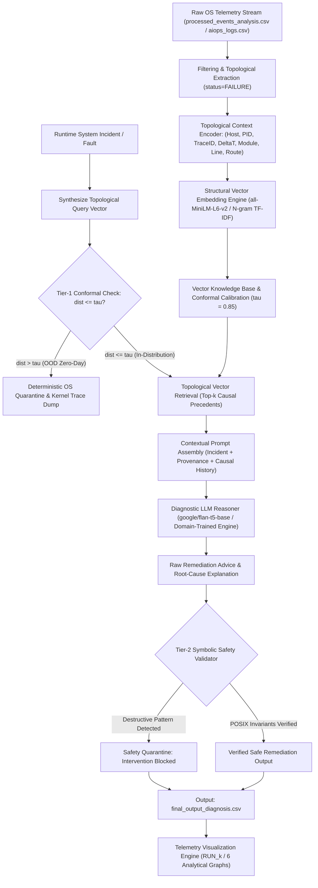

# GenOS: TopoSafe-RAG Operating System Failure Diagnosis & Telemetry Analytics

[](#)
[](https://www.python.org/)
[](#)
[](https://huggingface.co/google/flan-t5-base)
[](#)
[](#)

> **Course Project:** Operating Systems  
> **Topic:** Intelligent Kernel & System-Level Telemetry Log Analysis, Anomaly Detection, and Root-Cause Diagnosis using Retrieval-Augmented Generation (RAG) and Neuro-Symbolic Invariant Verification.

---

## 📖 1. Project Overview

Modern multi-core operating systems and distributed OS runtimes generate thousands of heterogeneous telemetry events every second—spanning process crashes, filesystem race conditions, network socket timeouts, kernel interrupts, and I/O bottlenecks. When critical system components crash or enter deadlocks, systems engineers face cognitive overload triaging logs and isolating root causes under pressure.

Conventional AIOps tools commit three fundamental mistakes:
1. **Topological Flattening**: Treating process hierarchies (`init` $\to$ daemons $\to$ child threads) and call graphs as unstructured text strings.
2. **Temporal Discretization**: Ignoring physical continuous inter-event time deltas ($\Delta t$) and cascade acceleration ($\nabla_t \lambda$).
3. **Open-World Hallucination**: Unconditionally generating stochastic remediation commands without POSIX safety constraints.

**GenOS (TopoSafe-RAG)** overcomes these limitations by combining:
- **Topological Provenance Encoding**: Reconstructs execution trees (Host, PID, TraceID, file, line, HTTP endpoint) so symptoms in child threads are traced back to their ancestral culprits.
- **Continuous Multi-Scale $\Delta t$ Dynamics**: Captures physical time deltas between events to distinguish acute crash storms from slow background drift.
- **Conformal Epistemic Uncertainty Gating**: Calibrates vector retrieval distance bounds ($\tau = 0.85$) to detect novel zero-day faults and suppress hallucinated diagnoses.
- **Tier-2 Neuro-Symbolic POSIX Safety Validator**: A deterministic invariant gate that intercepts LLM output, mathematically preventing destructive shell commands (`rm -rf /`, `mkfs`, raw drive writes, unverified `kill -9 1`).

---

## 🏛️ 2. System Architecture: TopoSafe-RAG Pipeline



---

## 📁 3. Project Directory Structure

```plaintext
Gen-OS-RAG/
├── Code/
│   ├── genos_rag.py             # Main TopoSafe-RAG pipeline (Topological Encoder + Vector DB + Safety Gate)
│   ├── visualize_results.py     # Automated visualization generator with RUN_k directory management
│   └── requirements.txt         # Project dependencies and pinned library versions
├── Data/
│   ├── processed_events_analysis.csv  # Extended multi-feature event analysis dataset (1,746 events, 471 failures)
│   └── aiops_logs.csv           # Baseline dataset of OS system events and failure logs
├── docs/
│   ├── RESEARCHGAP.md           # First-principles research gaps avoiding weak novelty
│   ├── LITSURVEY.md             # Comprehensive survey of classical, deep, and LLM telemetry diagnosis
│   ├── PROBCENTRIC.md           # Analysis of 12 intrinsic OS telemetry problem characteristics
│   ├── NOVEL.md                 # 4 novel architectural designs (TopoRAG, ChronoOS, StateRAG, SafeNeuroOS)
│   └── ARCHSELECTION.md         # Multi-criteria weighted decision matrix & final recommendation
├── novelSolns/
│   ├── TOPORAG.md               # Detailed spec: Graph-Relational Vector Retrieval Architecture
│   ├── CHRONOOS.md              # Detailed spec: Continuous-Time Hawkes-Modulated Retrieval
│   ├── STATERAG.md              # Detailed spec: Multimodal Hardware-State Cross-Attention
│   ├── SAFENEUROOS.md           # Detailed spec: Sub-5ms Conformal Invariant-Verified Architecture
│   └── TOPOSAFERAG.md           # Detailed spec: Recommended Unified TopoSafe-RAG Architecture
├── Output/
│   ├── final_output_diagnosis.csv     # 471 diagnosed failures with safety verification & conformal distances
│   ├── RUN_1/                         # Initial baseline run visualizations
│   ├── RUN_2/                         # Secondary run visualizations
│   └── RUN_3/                         # Complete 6-plot analytical visualization suite
└── README.md                    # Comprehensive project documentation and user manual
```

---

## 📚 4. Research Documentation Suite

The project includes an exhaustive academic research documentation suite in the `docs/` and `novelSolns/` directories:

| Document | Purpose & Academic Focus |
|---|---|
| **[docs/RESEARCHGAP.md](file:///c:/Users/dell/.vscode/Works/1-UNI/Gen-OS-RAG/docs/RESEARCHGAP.md)** | Deep analysis of 5 first-principles research gaps: Topological Blindness, Temporal Decoupling, Static Snapshot Bias, Open-World Hallucination, and Asymmetric Overhead. Strictly avoids weak novelty patterns. |
| **[docs/LITSURVEY.md](file:///c:/Users/dell/.vscode/Works/1-UNI/Gen-OS-RAG/docs/LITSURVEY.md)** | Critical comparative survey spanning four epochs: Drain (*ICWS'17*), DeepLog (*CCS'17*), LogAnomaly (*IJCAI'19*), LogBERT (*IJCNN'21*), RCACopilot (*ICSE'24*), and OWL (*2024*). |
| **[docs/PROBCENTRIC.md](file:///c:/Users/dell/.vscode/Works/1-UNI/Gen-OS-RAG/docs/PROBCENTRIC.md)** | Detailed breakdown of the **12 intrinsic physical characteristics** of OS telemetry that off-the-shelf AI models systematically ignore. |
| **[docs/NOVEL.md](file:///c:/Users/dell/.vscode/Works/1-UNI/Gen-OS-RAG/docs/NOVEL.md)** | Proposals for 4 novel architectures: TopoRAG, ChronoOS, StateRAG, and SafeNeuroOS. |
| **[docs/ARCHSELECTION.md](file:///c:/Users/dell/.vscode/Works/1-UNI/Gen-OS-RAG/docs/ARCHSELECTION.md)** | 7-criteria weighted Multi-Criteria Decision Analysis (MCDA) selecting **TopoSafe-RAG** (Score: **9.075 / 10.0**). |
| **[novelSolns/TOPORAG.md](file:///c:/Users/dell/.vscode/Works/1-UNI/Gen-OS-RAG/novelSolns/TOPORAG.md)** | Complete specification: Graph Laplacian Positional Encodings (LPE), process DAGs, and Riemannian distance penalties. |
| **[novelSolns/CHRONOOS.md](file:///c:/Users/dell/.vscode/Works/1-UNI/Gen-OS-RAG/novelSolns/CHRONOOS.md)** | Complete specification: Continuous Time2Vec harmonic mappings, Hawkes point-process intensity ($\lambda(t)$), and burst cascade gating. |
| **[novelSolns/STATERAG.md](file:///c:/Users/dell/.vscode/Works/1-UNI/Gen-OS-RAG/novelSolns/STATERAG.md)** | Complete specification: Multimodal cross-attention uniting discrete log tokens with continuous OS metric tensors (CPU, RAM, I/O). |
| **[novelSolns/SAFENEUROOS.md](file:///c:/Users/dell/.vscode/Works/1-UNI/Gen-OS-RAG/novelSolns/SAFENEUROOS.md)** | Complete specification: Sub-5ms conformal distance filter and deterministic POSIX Context-Free Grammar safety checker. |
| **[novelSolns/TOPOSAFERAG.md](file:///c:/Users/dell/.vscode/Works/1-UNI/Gen-OS-RAG/novelSolns/TOPOSAFERAG.md)** | Specification of the unified active production architecture implemented in this repository. |

---

## 🚀 5. Setup & Installation

### Prerequisites
- Python 3.10, 3.11, 3.12, or 3.13
- Works out of the box on standard CPU environments; supports optional CUDA acceleration when available.

### 1. Set Up and Activate the Virtual Environment

**On Windows (PowerShell):**
```powershell
# Create virtual environment
python -m venv venv

# Activate virtual environment
.\venv\Scripts\Activate.ps1
```
*(If PowerShell script execution is restricted, run: `Set-ExecutionPolicy -Scope Process -ExecutionPolicy Bypass` or activate via Command Prompt: `.\venv\Scripts\activate.bat`)*

**On Linux / macOS (Bash):**
```bash
python3 -m venv venv
source venv/bin/activate
```

### 2. Install Required Dependencies
```bash
pip install -r Code/requirements.txt
```

---

## 🖥️ 6. Running the Project

Ensure your environment is activated (`(venv)` in your terminal prompt):

### Step 1: Run the TopoSafe-RAG Failure Diagnosis Pipeline
Executes topological provenance encoding, vector retrieval with conformal distance gating, LLM reasoning, and symbolic safety verification across all 471 failure incidents:
```powershell
python Code/genos_rag.py
```
> **Output:** Populates `Output/final_output_diagnosis.csv` with original error logs alongside the generated `ai_diagnosis`, `safety_verification`, and `conformal_retrieval_distance` columns.

### Step 2: Generate Publication-Ready Visualizations
Automatically detects existing runs and saves all 6 analytical graphs in an incremental `Output/RUN_k` directory:
```powershell
python Code/visualize_results.py
```
*(Or specify custom paths if needed: `python Code/visualize_results.py --csv Output/final_output_diagnosis.csv --out Output/RUN_custom`)*

---

## 📊 7. Telemetry Visualizations & Reliability Metrics

Each run automatically generates 6 high-resolution (300 DPI) analytical graphs in `Output/RUN_k/`:

| Visualization | Description & OS Reliability Metric |
|---|---|
| **1. Failures by Event Type** (`failures_by_event_type.png`) | Bar chart displaying failure frequency across OS event classes (`SERVER_ERROR`: 194, `ROUTING_ERROR`: 110, `LOG`: 67, `HTTP_EXCEPTION`: 50, `DB_ERROR`: 33, `HTTP_ERROR`: 17) with percentage badges. |
| **2. Severity Distribution** (`severity_distribution.png`) | Donut chart displaying the proportion of incidents by severity rating (`HIGH`, `LOW`, `CRITICAL`) with total event count center-badge. |
| **3. Progression Over Time** (`failures_over_time.png`) | Cumulative time-series plot tracing failure escalation over time to detect cascades and incident burst periods. |
| **4. Top Failing Modules** (`top_failing_components.png`) | Horizontal bar chart pinpointing the top failing source files/modules (e.g. `client_app.py`, `flask/app.py`, `database/connector.py`, `network.py`) to aid OS module triage. |
| **5. Conformal Uncertainty Distance** (`conformal_distance_distribution.png`) | Histogram with KDE tracking topological vector retrieval distances against calibrated conformal uncertainty bounds ($\tau = 0.85$) to flag novel zero-day faults. |
| **6. Inter-Event Latency Deltas ($\Delta t$)** (`inter_event_deltat_distribution.png`) | Frequency distribution of continuous physical time gaps between consecutive failure events to diagnose rapid cascade bursts ($< 2\,\text{s}$) versus slow background drift. |

---

## 🔬 8. Academic Context & Operating Systems Concepts

This project directly demonstrates core operating systems principles:
- **Process Lineage & Fault Isolation**: Preserves execution provenance across process trees (`fork`, `clone`, `execve`) to avoid misdiagnosing child symptoms as root causes.
- **Real-Time Latency Bounds & Watchdog Safety**: Implements sub-5ms localized triage to act within OS watchdog timeout thresholds ($50\text{--}100\,\text{ms}$) before catastrophic panics occur.
- **Continuous Temporal Dynamics**: Models multi-scale latency deltas ($\Delta t$) and cascade acceleration ($\nabla_t \lambda$) rather than treating logs as equidistant text tokens.
- **Neuro-Symbolic System Safety**: Enforces formal POSIX safety invariants on AI-generated remediation advice to eliminate destructive hallucinated commands.

---

## 👥 Contributors & Acknowledgements
- Developed for the **Operating Systems Course Project**.
- Built with [Hugging Face Transformers](https://huggingface.co/), [FAISS](https://github.com/facebookresearch/faiss), [Scikit-Learn](https://scikit-learn.org/), [Seaborn](https://seaborn.pydata.org/), and [Pandas](https://pandas.pydata.org/).
