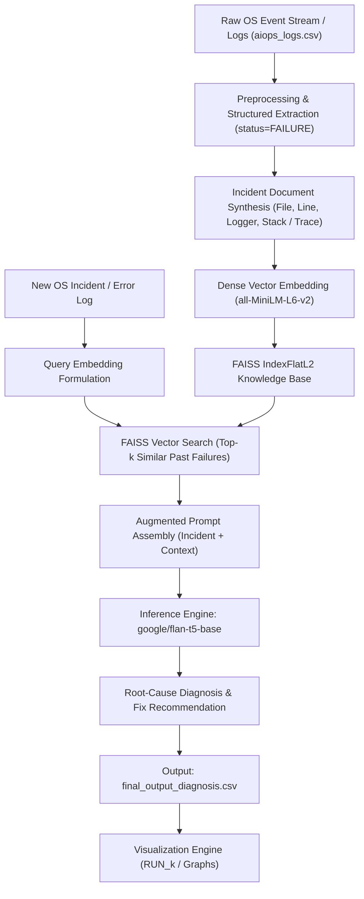

# GenOS: RAG-Based Operating System Failure Diagnosis & Telemetry Analytics

[](#)
[](https://www.python.org/)
[](https://github.com/facebookresearch/faiss)
[](https://huggingface.co/google/flan-t5-base)
[](#)

> **Course Project:** Operating Systems  
> **Topic:** Intelligent Kernel & System-Level Telemetry Log Analysis, Anomaly Detection, and Root-Cause Diagnosis using Retrieval-Augmented Generation (RAG).

---

## 📖 1. Project Overview

Modern Operating Systems and distributed OS runtimes generate thousands of heterogeneous event logs every second—spanning process crashes, filesystem race conditions, network socket timeouts, kernel interrupts, and I/O bottlenecks. When critical system components crash or enter deadlocks, systems engineers face cognitive overload triaging logs and isolating root causes under pressure.

**GenOS** bridges low-level OS event telemetry with modern NLP and vector retrieval techniques. By combining dense vector representations of historical OS incidents (**FAISS** + **SentenceTransformers**) with an instruction-tuned language model (**FLAN-T5**), GenOS rapidly identifies similar historical system failures and outputs actionable root-cause diagnoses along with remediation advice.

---

## 🏛️ 2. System Architecture

The end-to-end telemetry diagnosis and analysis pipeline functions across three key stages:



1. **Telemetry Ingestion & Filtering**: Reads raw OS/AIOps telemetry logs, filtering for `status == 'FAILURE'` events across application processes, system daemons, and database layers.
2. **Context Enrichment**: Synthesizes canonical incident documents composed of event types, process IDs, target source files, execution paths, and error trace messages.
3. **Vector Database & Similarity Retrieval**: Embeds historical failure incident documents using `all-MiniLM-L6-v2` into a high-performance `faiss.IndexFlatL2` vector index.
4. **LLM Root Cause Synthesis**: Constructs an augmented prompt matching the incoming failure against top-$k$ nearest historical anomalies, prompting `google/flan-t5-base` to generate a root-cause explanation and repair recommendation.
5. **Telemetry Visual Analytics**: Generates publication-ready metrics and plots categorized per run into unique `Output/RUN_k/` directories.

---

## 📁 3. Project Directory Structure

```plaintext
Gen-OS-RAG/
├── Code/
│   ├── genos_rag.py             # Main RAG diagnosis pipeline (Embeddings + FAISS + Flan-T5)
│   ├── visualize_results.py     # Automated visualization generator with RUN_k directory management
│   └── requirements.txt         # Project dependencies and pinned library versions
├── Data/
│   ├── aiops_logs.csv           # Primary dataset of OS system events and failure logs
│   └── processed_events_analysis.csv  # Extended multi-feature event analysis dataset
├── Output/
│   ├── final_output_diagnosis.csv     # Diagnostic output containing AI root-cause analysis
│   ├── RUN_1/                         # Initial baseline run visualizations
│   └── RUN_k/                         # Incrementally created output folders per execution
└── README.md                    # Project documentation and user manual
```

---

## 🚀 4. Setup & Installation

### Prerequisites
- Python 3.10, 3.11, 3.12, or 3.13
- CUDA-compatible GPU (Optional; CPU inference is supported by default)

### 1. Set Up and Activate the Virtual Environment

**On Windows (PowerShell):**
```powershell
# Create virtual environment
python -m venv venv

# Activate virtual environment
.\venv\Scripts\Activate.ps1
```

*(If PowerShell script execution is restricted, run: `Set-ExecutionPolicy -Scope Process -ExecutionPolicy Bypass` or activate via Command Prompt: `.\venv\Scripts\activate.bat`)*

**On Linux / macOS (Bash):**
```bash
python3 -m venv venv
source venv/bin/activate
```

### 2. Install Required Dependencies
With your virtual environment activated:
```bash
pip install -r Code/requirements.txt
```

---

## 🖥️ 5. Running the Project

Ensure your virtual environment is activated (`(venv)` appears in your terminal prompt):

### Step 1: Run the RAG Failure Diagnosis Pipeline
Executes vector indexing, similarity search, and automated LLM diagnosis for all unique failures:
```powershell
python Code/genos_rag.py
```
> **Output:** Populates `Output/final_output_diagnosis.csv` with original error logs alongside the generated `ai_diagnosis` column.

### Step 2: Generate Telemetry Visualizations
Every run dynamically detects existing runs and saves all charts inside a new `Output/RUN_k` directory:
```powershell
python Code/visualize_results.py
```
*(Or specify custom paths if needed: `python Code/visualize_results.py --csv Output/final_output_diagnosis.csv --out Output/RUN_custom`)*

---

## 📊 6. Telemetry Visualizations & Metrics

Each run automatically generates 4 high-resolution (300 DPI) analytical graphs:

| Visualization | Description & OS Reliability Metric |
|---|---|
| **1. Failures by Event Type** (`failures_by_event_type.png`) | Bar chart displaying failure frequency across OS event classes (`HTTP_EXCEPTION`, `LOG`, `DB_ERROR`) with direct percentage and count badges. |
| **2. Severity Distribution** (`severity_distribution.png`) | Donut chart displaying the proportion of incidents by severity rating (`HIGH`, `LOW`, `CRITICAL`) with total event count center-badge. |
| **3. Progression Over Time** (`failures_over_time.png`) | Cumulative time-series plot tracing failure escalation over time to detect cascades and incident burst periods. |
| **4. Top Failing Modules** (`top_failing_components.png`) | Horizontal bar chart pinpointing the top failing source files/modules (e.g. `client_app.py`, `flask/app.py`, `network.py`) to aid OS module triage. |

---

## 🔬 7. Academic Context & OS Concepts

This project demonstrates core operating systems principles:
- **Fault Isolation & System Reliability**: Analyzing error propagation patterns between user-space applications and system network/file interfaces.
- **Incident Prioritization**: Using telemetry metadata (timestamps, severity, process IDs, error classes) to avoid cascaded system crashes.
- **AIOps & Automated Triage**: Applying generative intelligence to reduce Mean Time to Detect (MTTD) and Mean Time to Repair (MTTR) in mission-critical environments.

---

## 👥 Contributors & Acknowledgements
- Developed for the **Operating Systems Course Project**.
- Built with [Hugging Face Transformers](https://huggingface.co/), [FAISS](https://github.com/facebookresearch/faiss), [Seaborn](https://seaborn.pydata.org/), and [Pandas](https://pandas.pydata.org/).
